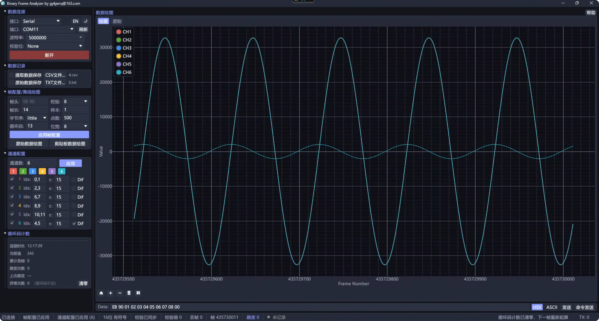
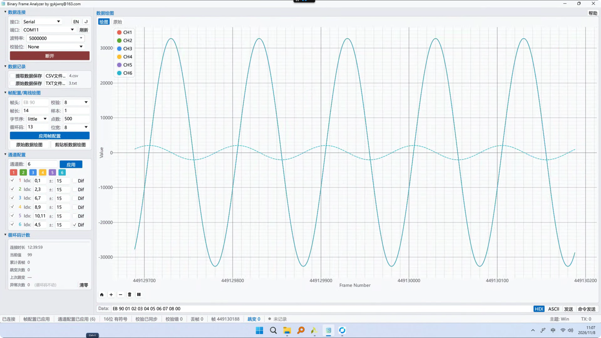
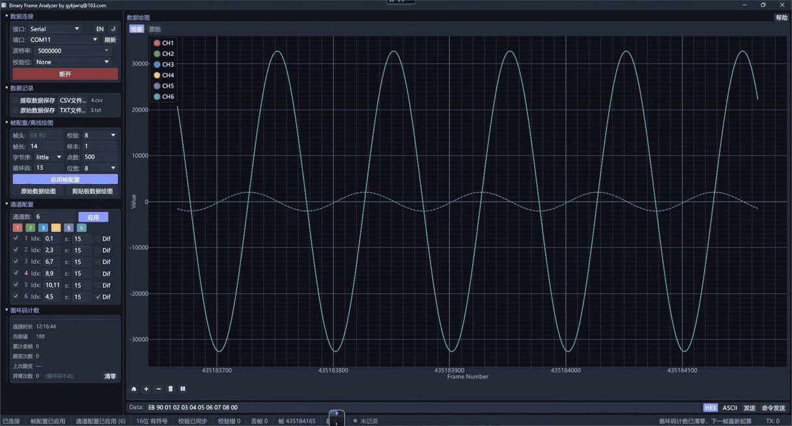
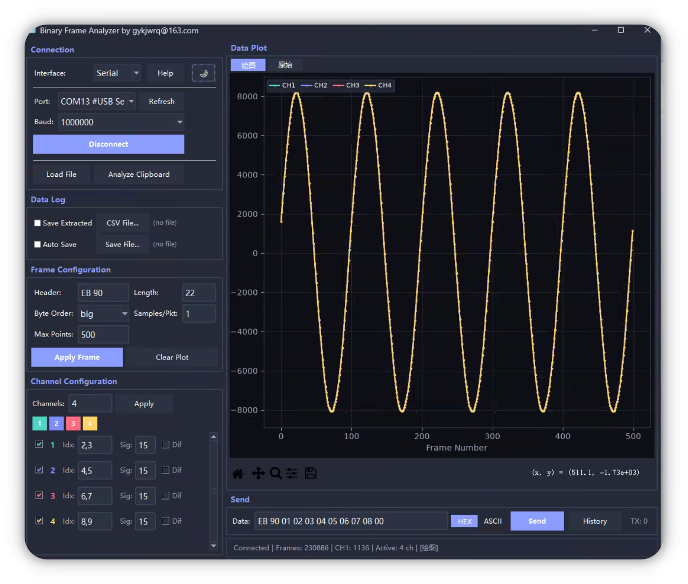

# 串口/网口调试助手 serial and udp tool

> **说明**：本仓库 `main` 分支现已改为 **Rust 实现**；旧 **Python** 版源码以及脚本、截图、视频等资源统一放在 [`legacy-python`](https://github.com/ebasegykj/serial_and_udp_tool/tree/legacy-python) 分支。

帧析助手，给 FPGA / 嵌入式调试用的**二进制帧实时解析与绘图工具**。

**以前调一块板卡，想看一条通道曲线，得走完这一整串**：

1. 把串口 / UDP 收到的原始字节流复制粘贴到别的工具
2. 手动找帧头、按帧长分帧
3. 逐字节转成十进制
4. 导进 Excel 或 MATLAB
5. 再写脚本把图画出来

帧没找准，后面全白算；板卡改一次帧格式，这五步又得从头来一遍；而且全是事后处理，运行时有没有丢帧、有没有对不齐，当时根本看不见。

**现在这五步全没了**：连上串口或 UDP，帧头、帧长、字节序、校验、通道位宽在界面上配一次就存住；字节流进来直接按帧解出各通道十进制值并实时成图，CSV / txt 一边收一边落盘，要回灌 MATLAB 做后处理也是现成的。没对齐就不画图（不会塞给你一条假波形），校验错、丢帧当场计数。

## 什么时候会用到它

- **测 AD 采样**：多路采样值直接实时成曲线，某一路有没有跳变、饱和、少点，一眼看得出来；UDP 多采样点大包按每采样点自动展开，不用先手工拆包。
- **核对外接设备送来的数对不对**：帧头、校验错、循环码丢帧计数常驻状态栏，数据有没有错、有没有少，收的当时就知道；原始字节流还能留一份 txt 底稿，回头和预期逐字节比。
- **验证 FPGA 数据收发**：HEX / ASCII 直接下发激励，回包当场解成通道值画图，发和收在一个窗口里齐活，不用再开第二个串口工具。
- **不挑板卡**：不依赖具体 FPGA 型号、厂商工具或上位机语言，只要数据是走串口或 UDP 出来的字节流，就能接进来分析。

## 帧结构自己配
- 帧头（任意长度十六进制）、帧长、字节序（大端 / 小端）、校验和（no / 8 / 16 位）、每包采样数、最大显示点数，界面上改完立即生效。
- 没有帧头时，连续两帧校验通过才锁定分帧起点，没对齐就不画图；连续 3 帧失败自动失锁重搜。不会把错位字节当成有效数据，省得对着假波形查半天。

## 通道随便切，位宽不将就
- 1-8 通道，每通道索引可指定帧内任意字节组合（如 `3,4`），8-32 位任意切片，支持符号位与一阶差分；大小端、位宽、符号位都按板卡实际格式配，不用为了看个数去改固件。
- UDP 多采样点大包模式下，按每采样点字节数自动展开整包，包尾多余字节自动忽略。

## 错帧、丢帧当场看得见
- 校验错实时计数；可指定帧内循环码的位置和位宽（8/16/24/32），按回绕差值直接统计丢帧总数。设备重启、断连重连后点一下「清零」就能接着数，不用自己对包号。
- 连接、帧数、通道视图、校验错、丢帧、等待同步等状态常驻状态栏，一路收数一路盯。

## 数据能带走，也能回放
- 提取后的通道数值实时存 CSV（帧号 + 各通道十进制值），原始字节流实时存 txt，两种保存可同时开。CSV 直接丢给 MATLAB / Python / Excel 做后处理。
- 也能加载十六进制数据文件、或直接分析剪贴板，断连之后照样离线复盘。

## 调试顺手
- HEX / ASCII 命令下发，历史记录可重发；调板卡寄存器不用另开一个串口工具。
- 曲线滚轮缩放、拖拽平移、可暂停；中英双语界面；Windows 下 exe 开箱即用（见下方下载）。

## 新rust版本

老python版本

## 下载

- [最新版 exe](https://github.com/ebasegykj/serial_and_udp_tool/releases/latest)
## 使用说明 
╔══════╗
二进制帧分析工具(帧析助手) 使用说明  
作者: RhycWu                
邮箱: gykjwrq@163.com       
╚═════╝

【首次使用】

 python版
  1. 安装 Python 3.8 或更高版本
  2. 安装依赖库：
     pip install pyserial matplotlib

  3. 运行程序：
     python 8.py

 Windows版
  双击exe

【接口选择】

  串口（Serial）：
    - 端口（Port）：选择串口号（点击 Refresh 刷新列表）
    - 波特率（Baud）：9600 ~ 3000000 可选

  网口（UDP）：
    - 本地 IP（Local IP）：绑定的网卡地址（默认 0.0.0.0 = 所有网卡）
    - 本地端口（Local Port）：监听的 UDP 端口
    - 远程 IP（Remote IP）：发送数据的目标 IP（可选）
    - 远程端口（Remote Port）：发送数据的目标端口（可选）
    - 说明：如果不填远程 IP/端口，程序会自动回复给向你发送数据的地址

【帧配置（Frame Configuration）】

  帧头（Frame Header）：
    - 标记一帧开始的十六进制字节
    - 例如：EB 90
    - 可以是任意长度（1字节、2字节等）

  帧长（Frame Length）：
    - 每帧的总字节数（包含帧头）
    - 多采样点大包模式下，填整个数据包的大小

  字节序（Byte Order）：
    - 大端（Big Endian）：高位字节在前
    - 小端（Little Endian）：低位字节在前

  每包采样数（Samples/Pkt）：
    - 每个数据包中包含的采样点数量
    - 1 = 普通模式（每帧一个采样点，和串口一样）
    - >1 = 大包模式（每帧多个采样点）
    - 程序会根据通道索引配置自动计算每个采样点的大小

  最大显示点数（Max Points）：
    - 曲线图上最多显示多少个数据点
    - 超过后旧数据从左侧滚动消失

  应用帧配置（Apply Frame）：使帧配置生效
  清空曲线（Clear Plot）：清空所有绘图数据

【通道配置（Channel Configuration）】

  通道数量：1 ~ 8 路

  每个通道包含：
    - 索引（Idx）：通道数据在帧中的字节位置（从0开始）
      * 用逗号分隔：3,4 （2字节）
      * 支持分隔符：英文逗号、空格、中文逗号、中文顿号
      * 例如：通道数据在第5和第6字节，输入：5,6

    - 符号位（Sign）：符号位的位置（-1 表示无符号）
      * 例如：16位有符号数，填 15（第15位是符号位）
      * 修改索引后会自动更新默认值

    - 一阶差分（1st Diff）：启用一阶差分计算
      * 显示相邻两个采样点的差值
      * 用虚线绘制

  应用通道配置（Apply Channel）：使通道配置生效

【数据发送】

  发送格式：
    - HEX：发送原始十六进制字节（空格/换行分隔）
    - ASCII：发送文本，按ASCII编码

  历史记录（History）按钮：
    - 查看之前发送过的命令
    - 双击或点"立即发送"可直接重发
    - 点"载入输入框"可加载到发送框修改后再发

【数据保存】

  自动保存原始数据（Auto Save）：
    - 自动将所有接收到的原始数据保存到文件
    - 格式：空格分隔的十六进制字节
    - 点击"Save File..."选择保存文件

  保存提取数据（Save Extracted）：
    - 自动将提取后的通道数值保存为CSV文件
    - 格式：帧号, 通道1, 通道2, 通道3, ...
    - 点击"CSV File..."选择保存文件

【离线分析】

  加载文件（Load File）：
    - 加载十六进制数据文件进行离线分析
    - 显示内容：帧数、各通道值范围、首尾值

  分析剪贴板（Analyze Clipboard）：
    - 分析复制到剪贴板的十六进制数据
    - 输出格式和加载文件相同

【多采样点大包模式（UDP）】

  当 Samples/Pkt > 1 时：
    - 每个 UDP 数据包包含多个采样点
    - 程序会自动提取每个包中的所有采样点
    - 所有采样点正常绘图和保存
    - 包尾部多余的字节自动忽略

  示例：832字节包，100个采样点
    - 帧头：EB 90
    - 帧长：832
    - 每包采样数：100
    - CH1 索引：3,4 （第一个采样点的通道1在第3、4字节）
    - CH2 索引：5,6
    - ...
    - 程序自动计算：每个采样点 = 8 字节
    - 100个采样点 × 8字节 = 800字节采样数据
    - 剩余字节（832 - 2 - 800 = 30）自动忽略

【鼠标和键盘操作】

  曲线图：
    - 滚轮：放大/缩小
    - 左键拖动：平移
    - 右键菜单：更多功能（缩放、保存等）

  发送：
    - 在发送框中按回车直接发送

【常见问题】

  "无法打开串口"：
    1. 点击 Refresh 刷新，确认端口是否存在
    2. 确认没有其他程序占用该串口
    3. 检查 USB 线是否连接好

  "收不到数据"：
    1. 确认波特率/端口设置正确
    2. 确认帧头和数据格式匹配
    3. 检查字节序（大端/小端）是否正确

  "UDP 无法绑定端口"：
    1. 端口可能被其他程序占用
    2. 换一个端口号试试
    3. 如果端口 < 1024，需要管理员权限

  "没有远程地址"（UDP发送）：
    1. 手动填写远程 IP 和远程端口
    2. 或者先接收一次数据（程序会自动学习发送方地址）

